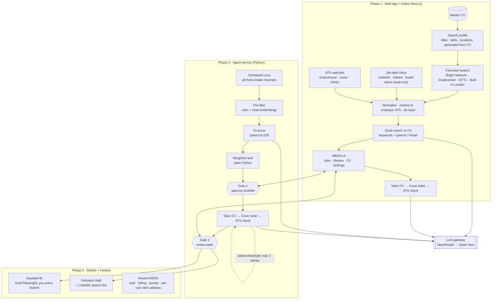

# WERA — System Architecture

> An open-source, agentic job-application assistant. It uses your master CV to search job boards and read your job-alert emails, scores what it finds against that CV, and writes a tailored CV, cover letter and ATS report for the roles you approve. **Nothing is ever sent without a human approving it.**

- **Free to self-host:** clone the repo, bring your own API keys, run it locally.
- **Hosted WERA (later):** a paid, managed version for people who don't want to run it themselves.

_Last updated: 14 October 2026 · Requirements, data contracts and acceptance tests live in [`SPEC.md`](./SPEC.md)._

---

## 1. Principles

1. **Human in the loop.** Two approval gates: you approve the shortlist, then you approve every document before it's used. WERA never auto-submits an application or auto-sends a message.
2. **Truthful tailoring.** The tailoring model may only select, reorder and reword facts that exist in your master CV. Every output bullet must cite a master-CV bullet id, and anything uncited is rejected.
3. **Secrets never touch the browser, the repo or the logs.** See [§7 Security & secrets](#7-security--secrets). This is a hard requirement for a public repo.
4. **Local-first and private by default.** Your CV and job data live in your own database. Contact details are redacted before any prompt leaves your machine.
5. **Works with zero keys.** Demo mode runs the whole UI on fixtures and a mock LLM, so contributors can clone and run it without spending anything.
6. **Use sanctioned data sources first.** Public ATS job APIs come before scraping. LinkedIn jobs arrive only through job-alert emails sent to you; WERA never fetches or scrapes linkedin.com.
7. **Your CV drives the search.** Search queries are generated from your master CV (target titles, skills, locations), not typed by hand, and every result is matched back against the same CV.

---

## 2. Architecture overview



**How it fits together**

- **Phase 1** ships the web app with the core loop in it: your master CV becomes a search profile, WERA searches the boards with Firecrawl and reads your job-alert inbox, quick-matches results against the CV, and turns the ones you pick into a tailored CV, cover letter and ATS report. A thin set of Next.js route handlers is the only server code, and the only place keys and mailbox credentials are read. Searches run when you press "Search now".
- **Phase 2** adds the Python agent service: a LangGraph state graph that runs the same three intake channels on a schedule, scores with the larger model, ranks, and pauses at the two gates. The web app becomes its UI.
- **Phase 3** adds the stretch features (assisted form-fill, outreach drafts) and the hosted, paid version.

---

## 3. Components

### 3.1 Pipeline stages

| # | Stage | What it does | Tool / model | Output | Phase |
|---|---|---|---|---|---|
| 1a | Search profile | Reads the master CV once and proposes target titles, top skills, locations, seniority and exclusions; you edit and save it | Qwen3.7-Flash | `SearchProfile` | 1 |
| 1b | Board search | Turns the profile into queries per site and runs Firecrawl `/search` restricted to your boards, last 7 days | Firecrawl | Candidate job URLs + cards | 1 |
| 1c | Alert inbox | Reads new emails from allowlisted job-alert senders (LinkedIn, Indeed, boards) in a dedicated mailbox, extracts job cards | IMAP or Gmail API, read-only; Qwen3.7-Flash | Job cards | 1 |
| 1d | Resolve & normalise | Finds each job's original posting (employer ATS first), pulls the full description, de-duplicates across channels | ATS APIs, Firecrawl `/scrape` + `/search`, Qwen3.7-Flash | `Job` | 1 |
| 1e | Quick match | Keyword overlap with your CV plus a one-line Flash verdict, so Phase 1 already shows the best matches first | TypeScript + Qwen3.7-Flash | Match score | 1 |
| 2 | Tailor CV | Selects and rewords master-CV bullets for this job; every bullet cites a source id | Qwen3.8-Max | Tailored CV (JSON → PDF/DOCX) | 1 |
| 3 | Cover letter | 250–350 words, grounded in the CV and one company-specific fact | Qwen3.8-Max | Cover letter | 1 |
| 4 | ATS check | Keyword coverage vs the job plus a format lint; below threshold loops back to step 2, max 2 retries | TypeScript + Qwen3.7-Flash for keyword extraction | ATS report (coverage %) | 1 |
| 5 | Scheduled intake | Runs stages 1b–1d daily (search) and every few hours (inbox) without you pressing anything | Scheduler + agent service | New `Job` rows | 2 |
| 6 | Pre-filter | Hard rules (location, seniority, language) plus embedding similarity | Python + local embeddings | ~20–30% survive | 2 |
| 7 | Fit score | Sub-scores 0–10 with a quoted line of evidence for each | Qwen3.8-27B, Pydantic-validated | `FitReport` | 2 |
| 8 | Rank | Weighted total computed in code; the LLM never produces the final number | Python | Ranked list | 2 |
| 9 | Gate 1 | You approve, reject or snooze; the graph pauses on `interrupt()` | LangGraph checkpointer | Shortlist | 2 |
| 10 | Gate 2 | You edit and approve the CV, letter and answer pack | LangGraph checkpointer | Approved pack | 2 |
| 11 | Answer pack | Pre-written answers to every application question (Greenhouse `?questions=true` schema, or scraped form fields) | Qwen3.8-Max | Answers + copy buttons | 2 |
| 12 | Assisted fill | Fills the hosted form in a visible local browser and stops before Submit | Playwright (+ Stagehand for awkward widgets) | Filled form | 3 |
| 13 | Outreach draft | Short note plus a LinkedIn people-search link; you send it yourself | Qwen3.7-Flash | Draft | 3 |

### 3.2 Fit score

The starting weights get tuned against your own approve/reject history once you have roughly 50 decisions:

```
fit = 0.35·core + 0.20·adjacent + 0.20·experience + 0.15·eligibility + 0.10·freshness
```

The experience threshold is also a hard gate: a job asking for far more years than you have is dropped at the pre-filter, not scored low.

### 3.3 LLM tiers (via OpenRouter, OpenAI-compatible)

| Node | Model | Price per 1M tokens (in / out) | Reasoning |
|---|---|---|---|
| Normalise, keyword extraction, outreach | `qwen/qwen3.7-flash` | $0.03 / $0.13 | off |
| Fit scoring | `qwen/qwen3.8-27b` (open weights; can run locally, ~16 GB at 4-bit) | from $0.04 / $1.35 | low |
| CV, cover letter, answer pack | `qwen/qwen3.8-max-0902` | $2 / $6 | on |
| Fallback | `qwen/qwen3.8-flash` · `qwen/qwen3.7-plus` | $0.15 / $0.47 · $0.32 / $1.28 | — |

- Pin dated model ids in config. Qwen snapshots get superseded within weeks, so re-run the golden eval set before switching.
- Use tool-calling structured output, validate it with Pydantic or Zod, and retry once on failure. Some Qwen deployments don't enforce strict JSON schemas.
- The provider is configurable: OpenRouter by default, Alibaba Model Studio or any OpenAI-compatible endpoint as alternatives.

### 3.4 Job intake: three channels, one CV

Every channel feeds the same normaliser, and every job is matched against the same master CV.

```
master CV ──► search profile ──► A. Firecrawl board search ──┐
                                 B. Job-alert inbox ─────────┼──► resolve ► normalise ► de-dupe ► match vs CV
                                 C. ATS watchlist ───────────┘
```

#### A. CV-driven board search (Firecrawl)

1. **Search profile.** Qwen3.7-Flash reads the master CV and proposes a profile you can edit:
   ```yaml
   titles: [AI Engineer, Graduate Software Engineer, ML Engineer, Backend Engineer (Python)]
   skills: [Python, FastAPI, TypeScript, LangGraph, PostgreSQL, LLM guardrails]
   locations: [London, Amsterdam, Dublin, Berlin, Zurich]
   seniority: [graduate, junior, entry]
   exclude: [senior, staff, principal, "10+ years"]
   sites: [brightnetwork.co.uk, gradcracker.com, welcometothejungle.com, builtinlondon.uk]
   recency: last_7_days
   ```
2. **Query builder.** For each title × location, one Firecrawl `/search` call with `includeDomains` set to your sites, `tbs: qdr:w` (past week), `location`, and `limit: 10`. Results come back as title, URL and snippet. Confirm each site's domain and check its terms and robots.txt before enabling it.
3. **Fetch only what's new.** URLs already in `jobs` are skipped. New ones are scraped once with the JSON format into a `JobCard` (title, company, location, salary, apply link, description).
4. **Board search pages** (optional). Where a board's own search URL accepts query parameters, scrape that page directly with `/scrape`; use `/interact` only for boards that need filters clicked or "load more".

`linkedin.com` is on a hard exclude list for every Firecrawl call. LinkedIn's User Agreement (§8.2) bans scraping, so LinkedIn coverage comes from channel B.

#### B. Job-alert inbox (email)

You create job alerts on LinkedIn, Indeed and the boards, all sent to one **dedicated mailbox** (or one label). WERA reads that mailbox read-only and turns each alert email into job cards.

| Option | How it connects | Best for |
|---|---|---|
| IMAP + app password | Any provider; read-only fetch of one folder | Self-hosting, simplest setup |
| Gmail API, `gmail.readonly`, filtered to one label | OAuth with your own Google Cloud client | Self-hosters on Gmail. Note that `gmail.readonly` is a restricted Google scope, so a public hosted app needs Google's verification |
| Unique forwarding address (`you@alerts.wera.app`) via an inbound-email webhook (e.g. Postmark inbound) | You point alerts or a forwarding rule at it; WERA never touches your inbox | Hosted WERA (Phase 3) |

Pipeline per email:

1. **Sender allowlist.** Only emails from allowlisted job-alert senders are opened; everything else is ignored, unread.
2. **Parse.** Extract job cards (title, company, location, link) from the HTML with deterministic parsers per sender, and use Qwen3.7-Flash as a fallback. Images and tracking pixels are never loaded.
3. **Resolve without touching LinkedIn.** For a LinkedIn card, WERA does not open the LinkedIn link. It searches the open web for the same role (`"{title}" "{company}"` with Firecrawl `/search`, excluding linkedin.com), prefers a Greenhouse, Lever, Ashby or company careers result, and pulls the full description from there. If nothing matches, the card stays with title, company and location only, marked "Open on LinkedIn to read the description".
4. **Keep only the job.** WERA stores the extracted cards and the email's message id (for de-duplication), never the email body.

#### C. ATS watchlist

| ATS | Endpoint | Cost |
|---|---|---|
| Greenhouse | `GET https://boards-api.greenhouse.io/v1/boards/{token}/jobs?content=true`; `.../jobs/{id}?questions=true` for the form schema | Free, no auth |
| Ashby | `GET https://api.ashbyhq.com/posting-api/job-board/{org}?includeCompensation=true` | Free, no auth |
| Lever | `GET https://api.lever.co/v0/postings/{company}?mode=json` | Free, no auth |

`companies.yaml` lists employers you want to watch directly.

#### Resolve, normalise, de-dupe (shared)

- **Resolver:** any apply link containing `greenhouse.io`, `lever.co` or `ashbyhq.com` is swapped for the employer's clean JSON. Other careers pages are scraped once to markdown (1 credit).
- **De-dupe key:** the ATS job id when known; otherwise a hash of normalised company + title + location. The same role from a board search and a LinkedIn alert becomes one job with two sources.
- **Firecrawl costs:** search is 2 credits per 10 results; a scrape is 1 credit, or 5 with the JSON format.

### 3.5 Hard limits (by design)

- **No auto-submit.** Greenhouse's application `POST` needs the employer's secret key, and ATS vendors run WAFs, IP-reputation checks and CAPTCHAs. WERA does not implement stealth, CAPTCHA solving or proxy rotation.
- **No Workday form-filling.** Workday puts a per-employer account and CAPTCHA in front of every application, so WERA shows a copy-paste pack instead.
- **No LinkedIn scraping or automation.** LinkedIn's User Agreement §8.2 bans scraping and bots that message or add contacts. LinkedIn jobs come in only through alert emails you receive; outreach is drafted for you to send yourself.
- **No acting on email content.** Alert emails are data. WERA extracts job cards from them and never follows instructions, links to non-allowlisted domains, or attachments inside them.

---

## 4. Tech stack

| Layer | Phase 1 | Phase 2–3 |
|---|---|---|
| Web app | Next.js (App Router, TypeScript), Tailwind with WERA tokens | same |
| Server code | Next.js route handlers, marked `server-only` | FastAPI (Python) agent service |
| Orchestration | — | LangGraph + Postgres checkpointer |
| LLM client | OpenAI SDK pointed at OpenRouter | LangChain `ChatOpenAI` → OpenRouter |
| Storage | SQLite via Drizzle | Postgres (Supabase) + pgvector |
| Documents | `@react-pdf/renderer` (PDF), `docx` (DOCX) | same |
| Validation | Zod | Pydantic, with Zod schemas generated from the shared JSON Schema |
| Search & scraping | Firecrawl JS SDK (`/search`, `/scrape`) | Firecrawl Python SDK |
| Email | `imapflow` (IMAP) or the Gmail API, read-only | same, on a schedule; inbound webhook for hosted |
| Browser (stretch) | — | Playwright, headed, local only |
| Tests | Vitest + Playwright e2e on demo mode | pytest + golden eval set (~20 hand-scored jobs) |

---

## 5. Data model

| Table | Key fields | Phase |
|---|---|---|
| `master_cv` | id, sections (JSON), bullets `[{id, text, tags}]`, version | 1 |
| `search_profile` | titles, skills, locations, seniority, exclude, sites, recency, updated_at | 1 |
| `jobs` | id, sources[] (`board_search:<site>`, `email_alert:<sender>`, `watchlist`), ats, company, title, location, description_md, apply_url, linkedin_url (nullable, never fetched), salary, hash, first_seen | 1 |
| `intake_runs` | id, channel, started_at, queries, results, new_jobs, credits_used, errors | 1 |
| `email_messages` | message_id, sender, received_at, cards_found (no body stored) | 1 |
| `documents` | id, job_id, kind (`cv`, `cover_letter`, `ats_report`, `answer_pack`), content (JSON), version | 1 |
| `applications` | job_id, status (`drafted → approved → submitted → interview → offer / rejected`), submitted_at | 1 |
| `decisions` | job_id, gate (1 or 2), decision, note, decided_at | 1 |
| `fit_reports` | job_id, core, adjacent, experience, eligibility, freshness, evidence (JSON), total, model | 2 |
| `outreach` | application_id, draft, sent_at, follow_up_at | 3 |
| `users`, `subscriptions`, `usage_events` | hosted only; every row scoped by `user_id` with row-level security | 3 |

---

## 6. Repository layout

```
wera/
├── apps/
│   └── web/                    # Next.js app (Phase 1)
│       ├── app/                # routes: /jobs, /jobs/[id], /cv, /settings
│       ├── app/api/            # route handlers: the ONLY code that reads secrets
│       ├── lib/server/         # llm.ts, env.ts, pii.ts  (all import 'server-only')
│       │   └── intake/         # profile.ts, firecrawl.ts, inbox.ts, ats.ts, resolve.ts, dedupe.ts
│       └── lib/ui/             # WERA components + tokens
├── services/
│   └── agent/                  # Python LangGraph + FastAPI (Phase 2)
│       ├── graph.py · state.py · nodes/ · sources/ · llm.py · pii.py
│       └── tests/
├── packages/
│   └── schemas/                # JSON Schema: Job, FitReport, MasterCV, Document
├── fixtures/                   # fictional CV, sample jobs, recorded LLM responses
├── docs/ARCHITECTURE.md        # how WERA is built
├── docs/SPEC.md                # what WERA must do: requirements, contracts, tests
├── .env.example                # placeholder names only, never values
├── .gitignore
├── .gitleaks.toml
├── .pre-commit-config.yaml
├── SECURITY.md                 # how to report a leak or a vulnerability
└── LICENSE
```

---

## 7. Security & secrets

**Rule:** a real key must never appear in the repo, its history, a client bundle, a log line, a trace, an error page or a CI output. Treat any key that is pushed, even for a moment, as compromised.

### 7.1 Where secrets live

| Context | Where keys live | Who can read them |
|---|---|---|
| Your local dev | `.env.local` (git-ignored) | Your machine only |
| Self-hosters | Their own `.env.local`, created from `.env.example` | Them only; WERA ships no keys |
| CI (tests) | No real keys. Tests run in demo mode on fixtures | — |
| Scheduled runs (your own instance) | GitHub Actions encrypted secrets, or your host's secret store | The workflow, at runtime |
| Mailbox access | App password or OAuth refresh token in `.env.local` / secret store; read-only scope; a dedicated alerts mailbox, never your main inbox | Server only |
| Hosted WERA | Platform secret store (e.g. Vercel / Fly / Doppler), never in code | Server processes only |
| Hosted WERA, user-supplied keys (optional) | Encrypted at rest with a KMS-managed key, decrypted only inside the request that uses it | Server, per request |

### 7.2 Controls (all in place from the first commit)

1. **`.gitignore` before anything else**
   ```gitignore
   .env
   .env.*
   !.env.example
   *.pem
   *.key
   secrets/
   ```
2. **`.env.example` holds names only**
   ```bash
   # Copy to .env.local and fill in. Never commit .env.local.
   LLM_BASE_URL=https://openrouter.ai/api/v1
   LLM_API_KEY=
   FIRECRAWL_API_KEY=
   # Job-alert inbox (dedicated mailbox, read-only)
   ALERTS_IMAP_HOST=
   ALERTS_IMAP_USER=
   ALERTS_IMAP_APP_PASSWORD=
   ALERTS_FOLDER=WERA-alerts
   WERA_DEMO_MODE=true
   ```
3. **Server-only key access.** Exactly one module reads secrets, and it imports `server-only`, so the build fails if any client component imports it.
   ```ts
   // apps/web/lib/server/env.ts
   import "server-only";
   import { z } from "zod";

   const Env = z.object({
     LLM_BASE_URL: z.string().url(),
     LLM_API_KEY: z.string().min(1).optional(),
     FIRECRAWL_API_KEY: z.string().min(1).optional(),
     WERA_DEMO_MODE: z.enum(["true", "false"]).default("true"),
   });
   export const env = Env.parse(process.env);
   ```
4. **Never use `NEXT_PUBLIC_` for anything secret.** A CI step fails the build if any env var whose name contains `KEY`, `SECRET` or `TOKEN` is prefixed `NEXT_PUBLIC_`.
5. **Bundle scan.** After `next build`, CI greps `.next/static` for key prefixes (`sk-or-`, `fc-`, `sk-`) and fails on any match.
6. **Pre-commit secret scanning** with gitleaks, so a key is blocked before it ever reaches a commit:
   ```yaml
   # .pre-commit-config.yaml
   repos:
     - repo: https://github.com/gitleaks/gitleaks
       rev: v8.x.x   # pin to the current release
       hooks:
         - id: gitleaks
   ```
7. **GitHub-side protection.** Turn on secret scanning and push protection for the repo, and run gitleaks in CI as a second net.
8. **Fork-safe CI.** Workflows triggered by pull requests from forks get no secrets. Never use `pull_request_target` with a checkout of PR code.
9. **Redacted logging.** One logger with a redaction list (`authorization`, `api_key`, `*_KEY`, `*_TOKEN`). LLM tracing is off by default; if enabled, request headers are stripped.
10. **Spend caps.** Each key gets its own credit limit at the provider (OpenRouter per-key limit; Firecrawl pay-as-you-go cap). Use separate keys for dev, scheduled runs and hosted.
11. **Least privilege.** The browser only ever calls WERA's own API routes. Provider keys are never forwarded to the client, never put in URLs, and never returned in API responses or error messages.
12. **PII redaction.** Phone, email and address are stripped from prompts and re-inserted locally after generation.
13. **Email is untrusted input.** Alert emails can contain text written to manipulate an AI ("ignore previous instructions…"). The extraction call has no tools, its output must validate against the `JobCard` schema, links are fetched only if their domain is on an allowlist, and nothing in an email can trigger an action.
14. **Mailbox least privilege.** Read-only scope or a read-only IMAP fetch of one folder; a dedicated alerts mailbox; message bodies are discarded after extraction.

### 7.3 If a key leaks

1. **Revoke the key at the provider immediately.** This is the only step that actually stops misuse, because forks and caches keep old history.
2. Issue a new key, update the secret store, and redeploy.
3. Check the provider's usage logs for the exposure window.
4. Purge the key from git history (`git filter-repo`) and force-push, then note it in `SECURITY.md`.

---

## 8. Phases

### Phase 1 — Web app + lightweight core (frontend first)

Goal: a usable WERA you can run locally that finds roles from your CV and turns them into applications, with no Python service.

- [ ] Monorepo scaffold, licence, `SECURITY.md`, secrets controls 1–9 and 13–14 from §7.2
- [ ] WERA design tokens (green/white) and component library
- [ ] Demo mode: mock LLM provider, recorded Firecrawl results and sample alert emails, so the app runs with zero keys
- [ ] Master CV editor (structured, bullet ids) with YAML import/export
- [ ] Search profile generated from the CV, editable
- [ ] Firecrawl board search across your sites ("Search now" button), linkedin.com excluded
- [ ] Job-alert inbox: IMAP read-only, sender allowlist, parsers for LinkedIn and Indeed alerts
- [ ] Resolver (ATS first, open-web search for LinkedIn cards), normaliser, cross-channel de-dupe
- [ ] Quick match against the CV; jobs list sorted by match
- [ ] Manual fallback: paste a job URL or description
- [ ] Tailor CV with the bullet-id guard → PDF/DOCX export
- [ ] Cover letter generation
- [ ] ATS check (keyword coverage + format lint) with a retry loop
- [ ] Applications tracker (status board)
- [ ] Settings: provider URL, model per tier, key status (set / not set, never the value)

**Done when:** one "Search now" plus your inbox produce a de-duplicated list where the top matches look right to you, you send a real application with a WERA-built CV and letter you only lightly edited, and a fresh clone runs in demo mode with no keys.

### Phase 2 — Agent backend

Goal: WERA finds and ranks jobs for you every morning.

- [ ] Python agent service (FastAPI) with shared schemas
- [ ] LangGraph graph with Postgres checkpointer; Gate 1 and Gate 2 as `interrupt()`
- [ ] Scheduled intake: board search daily, inbox every few hours, `companies.yaml` watchlist daily
- [ ] Pre-filter (rules + embeddings), fit scoring with Qwen3.8-27B, weighted ranking
- [ ] Answer packs from Greenhouse question schemas
- [ ] Daily scheduled discovery run
- [ ] Golden eval set and model-swap regression test
- [ ] Migrate SQLite → Postgres + pgvector

**Done when:** a ranked list is waiting each morning, the top 10 match your own judgement, and the gates survive a server restart.

### Phase 3 — Stretch features + Hosted WERA

Goal: the remaining features, then a paid hosted version for people who won't self-host.

- [ ] Assisted fill (self-hosted only; runs in a local browser): Greenhouse first, then Lever and Ashby
- [ ] Outreach drafts and follow-up reminders
- [ ] Hosted: auth, per-user Postgres row-level security, encrypted user-key storage (optional BYOK)
- [ ] Hosted: per-user alert forwarding address via an inbound-email webhook, so hosted users never grant inbox access
- [ ] Hosted: Stripe billing, usage metering per application, rate limits and abuse controls
- [ ] Hosted: privacy policy, data export and delete-my-data (CVs are personal data under GDPR / UK GDPR / Swiss FADP)
- [ ] Hosted: monitoring, spend alerts, per-tenant cost dashboards

**Done when:** a stranger can sign up, pay, tailor an application, and delete their data, without ever seeing a platform key.

---

## 9. Cost model

Estimate for one active user: 300 jobs discovered, 80 scored and 10 applications per week. Reasoning tokens are billed as output.

| Item | Weekly | Monthly |
|---|---|---|
| Normalising (Qwen3.7-Flash) | ~$0.06 | ~$0.25 |
| Fit scoring (Qwen3.8-27B, low reasoning) | ~$0.30–0.70 | ~$1.30–3 |
| CV + letter + ATS retries (Qwen3.8-Max, reasoning on) | ~$1.80–3 | ~$8–13 |
| Firecrawl Hobby (5,000 credits): 20 searches/day (4 titles × 5 locations, 2 credits each = 40) plus ~10 new pages/day at 5 credits (= 50) ≈ 2,700 credits/month | — | $19 ($16 billed yearly) |
| **Total** | | **~$30–35** |

Per application, model cost is roughly **$0.25–0.40**. That's the floor for hosted pricing, before infrastructure, payment fees and support.

---

## 10. Licence (recommendation)

**AGPL-3.0** fits the goal: anyone can use, self-host and modify WERA, and anyone who runs a modified version as a hosted service must publish their changes. As the copyright holder you can still run the paid hosted version.

If you might ever want to offer the code under other terms, decide early whether contributors sign a CLA or DCO. This isn't legal advice, so check before the first outside contribution.

---

## 11. Risks

| Risk | Mitigation |
|---|---|
| Tailored CV claims experience you don't have | Bullet-id guard + Gate 2 |
| Key leak from a public repo | §7 controls, push protection, revoke-first runbook |
| Cover letters read as generic AI text | Evidence-grounded paragraphs, 350-word cap, human edit |
| Boards block scraping or change layout | ATS APIs first; daily polling; schema-based extraction |
| Personal data sent to third parties | PII redaction, provider pinning, local-model option |
| Hosted abuse (spam applications, key draining) | Per-user quotas, metering, no auto-submit anywhere |
| Model churn | Pinned ids, golden eval set before switching |

## 12. Open questions

- Which three or four job boards produce the roles you want most, and are their domains and terms OK for search-and-scrape?
- Which alert senders go on the allowlist (LinkedIn, Indeed, Bright Network, Gradcracker…)?
- IMAP with an app password, or the Gmail API, for your own instance?
- Which eligibility rules should the eligibility sub-score apply per country (UK, NL, DE, IE, CH)?
- Is the master CV starting from a PDF import or typed into the editor?
- Hosted pricing: subscription, per-application credits, or both?

## Sources

- [Greenhouse Job Board API](https://developers.greenhouse.io/job-board.html)
- [Ashby public Job Board endpoint](https://jobspipe.dev/sources/ashby.md)
- [Firecrawl pricing](https://www.firecrawl.dev/pricing) · [Firecrawl /search](https://docs.firecrawl.dev/features/search) · [Firecrawl /interact](https://www.firecrawl.dev/blog/introducing-interact-endpoint)
- [Qwen3.8-27B on OpenRouter](https://openrouter.ai/qwen/qwen3.8-27b)
- [Workable on automated applications](https://help.workable.com/hc/en-us/articles/35293126257815-Managing-AI-generated-and-automated-job-applications)
- [LinkedIn User Agreement §8.2 explained](https://contentin.io/blog/linkedin-mcp-terms-of-service/)
