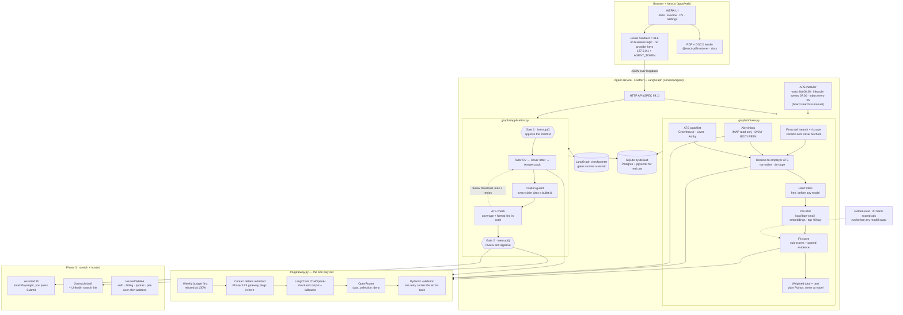

# WERA — System Architecture

> An open-source, agentic job-application assistant. It uses your master CV to search job boards and read your job-alert emails, scores what it finds against that CV, and writes a tailored CV, cover letter and ATS report for the roles you approve. **Nothing is ever sent without a human approving it.**

- **Free to self-host:** clone the repo, bring your own API keys, run it locally.
- **Hosted WERA (later):** a paid, managed version for people who don't want to run it themselves.

_Last updated: 14 October 2026 · Requirements, data contracts and acceptance tests live in [`SPEC.md`](./SPEC.md)._

---

## 1. Principles

1. **Human in the loop.** Two approval gates: you approve the shortlist, then you approve every document before it's used. WERA never auto-submits an application or auto-sends a message.
2. **Truthful tailoring.** The tailoring model may only select, reorder and reword facts that exist in your master CV. Every output bullet must cite a master-CV bullet id, and anything uncited is rejected.
3. **Secrets never touch the browser, the repo or the logs.** See [§7 Security & secrets](#7-security--secrets). This is a hard requirement for a public repo.
4. **Local-first and private by default.** Your CV and job data live in your own database. Contact details are redacted before any prompt leaves your machine.
5. **Works with zero keys.** Demo mode runs the whole UI on fixtures and a mock LLM, so contributors can clone and run it without spending anything.
6. **Use sanctioned data sources first.** Public ATS job APIs come before scraping. LinkedIn jobs arrive only through job-alert emails sent to you; WERA never fetches or scrapes linkedin.com.
7. **Your CV drives the search.** Search queries are generated from your master CV (target titles, skills, locations), not typed by hand, and every result is matched back against the same CV.

---

## 2. Architecture overview

As of Phase 2 the request path is fixed, and every feature travels it:

**WERA UI → Next.js BFF → FastAPI / LangGraph → LangChain → OpenRouter → Pydantic**



**How it fits together**

- **Python owns all the data and all the logic.** The Next.js route handlers are a backend-for-frontend: they forward to the agent over `127.0.0.1` with a shared `AGENT_TOKEN` and hold no provider keys (SEC-04). The one thing that stays in TypeScript is document rendering, because that is where the PDF and DOCX libraries are.
- **Every model call goes through one function.** `llm/gateway.py:structured()` is the only way to reach a model, so the weekly budget check, the contact redaction, the untrusted-data wrapping, the Pydantic validation and the `llm_calls` accounting cannot be forgotten by a node that was written in a hurry.
- **Pydantic is the canonical schema.** The models export JSON Schema to `packages/schemas/json/`, and the web app's TypeScript types are generated from it (SCH-03). There is one definition of a `Job`, and it is in Python.
- **The cheap checks run before the expensive ones.** Hard filters, then local embeddings, then a model — so by the time anything is paid for, the list is short (MATCH-01, MATCH-05).
- **The gates are real.** Gate 1 and Gate 2 are LangGraph `interrupt()` calls against a checkpointer, so a pending decision is still pending after the process restarts (REL-03, T-10).
- **Demo mode lives in the agent.** The same fixtures, the same schemas, no network (DEMO-02). A fresh clone with no keys runs the whole product.
- **Phase 3** adds the stretch features (assisted form-fill, outreach drafts) and the hosted, paid version.

---

## 3. Components

### 3.1 Pipeline stages

| # | Stage | What it does | Tool / model | Output | Phase |
|---|---|---|---|---|---|
| 1a | Search profile | Reads the master CV once and proposes target titles, top skills, locations, seniority and exclusions; you edit and save it | Qwen3.7-Flash | `SearchProfile` | 1 |
| 1b | Board search | Turns the profile into queries per site and runs Firecrawl `/search` restricted to your boards, last 7 days | Firecrawl | Candidate job URLs + cards | 1 |
| 1c | Alert inbox | Reads new emails from allowlisted job-alert senders (LinkedIn, Indeed, boards) in a dedicated mailbox, extracts job cards | IMAP or Gmail API, read-only; Qwen3.7-Flash | Job cards | 1 |
| 1d | Resolve & normalise | Finds each job's original posting (employer ATS first), pulls the full description, de-duplicates across channels | ATS APIs, Firecrawl `/scrape` + `/search`, Qwen3.7-Flash | `Job` | 1 |
| 1e | Quick match | Keyword overlap with your CV plus a one-line Flash verdict, so Phase 1 already shows the best matches first | TypeScript + Qwen3.7-Flash | Match score | 1 |
| 2 | Tailor CV | Selects and rewords master-CV bullets for this job; every bullet cites a source id | Qwen3.8-Max | Tailored CV (JSON → PDF/DOCX) | 1 |
| 3 | Cover letter | 250–350 words, grounded in the CV and one company-specific fact | Qwen3.8-Max | Cover letter | 1 |
| 4 | ATS check | Keyword coverage vs the job plus a format lint; below threshold loops back to step 2, max 2 retries | TypeScript + Qwen3.7-Flash for keyword extraction | ATS report (coverage %) | 1 |
| 5 | Scheduled intake | Runs stages 1b–1d daily (search) and every few hours (inbox) without you pressing anything | Scheduler + agent service | New `Job` rows | 2 |
| 6 | Pre-filter | Hard rules (location, seniority, language) plus embedding similarity | Python + local embeddings | ~20–30% survive | 2 |
| 7 | Fit score | Sub-scores 0–10 with a quoted line of evidence for each | Qwen3.8-27B, Pydantic-validated | `FitReport` | 2 |
| 8 | Rank | Weighted total computed in code; the LLM never produces the final number | Python | Ranked list | 2 |
| 9 | Gate 1 | You approve, reject or snooze; the graph pauses on `interrupt()` | LangGraph checkpointer | Shortlist | 2 |
| 10 | Gate 2 | You edit and approve the CV, letter and answer pack | LangGraph checkpointer | Approved pack | 2 |
| 11 | Answer pack | Pre-written answers to every application question (Greenhouse `?questions=true` schema, or scraped form fields) | Qwen3.8-Max | Answers + copy buttons | 2 |
| 12 | Assisted fill | Fills the hosted form in a visible local browser and stops before Submit | Playwright (+ Stagehand for awkward widgets) | Filled form | 3 |
| 13 | Outreach draft | Short note plus a LinkedIn people-search link; you send it yourself | Qwen3.7-Flash | Draft | 3 |

### 3.2 Fit score

The starting weights get tuned against your own approve/reject history once you have roughly 50 decisions:

```
fit = 0.35·core + 0.20·adjacent + 0.20·experience + 0.15·eligibility + 0.10·freshness
```

The experience threshold is also a hard gate: a job asking for far more years than you have is dropped at the pre-filter, not scored low.

### 3.3 LLM tiers (via OpenRouter, OpenAI-compatible)

`config/wera.yaml` is authoritative for model ids, prices and per-task token budgets; this table is a summary of it, and a person can change the model per tier in Settings.

| Tier | Model | Price per 1M tokens (in / out) | Reasoning | Tasks |
|---|---|---|---|---|
| fast | `qwen/qwen3.7-flash` | $0.03 / $0.13 | off | `keywords.extract`, `email.extract`, `profile.generate` |
| scoring | `qwen/qwen3.8-27b` (open weights; can run locally, ~16 GB at 4-bit) | $0.24 / $2.20 | low | `fit.score` |
| writing | `deepseek/deepseek-v4.1-flash-1017` | $0.15 / $0.60 | on | `cv.tailor`, `letter.write`, `answers.draft`, `guard.repair` |

Fallbacks are per tier and prefer a different vendor first, so a provider outage doesn't take every attempt with it: `mistralai/mistral-small-3.2-24b-instruct` then `google/gemini-2.5-flash-lite` behind fast, `qwen/qwen3.7-flash` behind scoring, `qwen/qwen3.8-27b` behind writing.

- **Pin dated model ids**, and run `uv run wera eval --model <id>` against the golden set before switching. Snapshots get superseded within weeks and a scoring tier that drifts two points high silently re-orders every morning's shortlist.
- **Structured output is `json_schema` with `strict=True`**, validated again with Pydantic using the master CV as validation context, and retried once with the validation errors carried back (§8.5).
- **Reasoning is explicit per task.** Today's models think by default, so "off" has to be sent, and a thinking budget is added on top of the answer budget — a model's thinking is billed against the same `max_tokens` ceiling, and without headroom the reply comes back cut off.
- **A cut-off reply is retried once with double the room.** How long a model thinks swings call to call; only generated tokens are billed, so the larger ceiling costs nothing unless it is used.
- **The provider is configurable:** OpenRouter by default, or any OpenAI-compatible endpoint via `LLM_BASE_URL` — including a local model, or the Phase 3 PII gateway via `LLM_PROXY_URL`.
- **Prices in config are a copy of a published price and go stale silently.** When OpenRouter reports a call's own cost it is preferred over the table; the table is used for the pre-flight budget estimate, where there is no reply to read a price from yet.

`config/wera.yaml` also lists `job.normalise`, `match.verdict` and `outreach.draft`. Nothing calls them yet: Firecrawl's own JSON extraction covers NORM-04 for scraped pages, quick match was replaced by fit scoring, and outreach is Phase 3. They cost nothing and are kept because the contracts are written.

### 3.4 Job intake: three channels, one CV

Every channel feeds the same normaliser, and every job is matched against the same master CV.

```
master CV ──► search profile ──► A. Firecrawl board search ──┐
                                 B. Job-alert inbox ─────────┼──► resolve ► normalise ► de-dupe ► match vs CV
                                 C. ATS watchlist ───────────┘
```

#### A. CV-driven board search (Firecrawl)

1. **Search profile.** Qwen3.7-Flash reads the master CV and proposes a profile you can edit:
   ```yaml
   titles: [AI Engineer, Graduate Software Engineer, ML Engineer, Backend Engineer (Python)]
   skills: [Python, FastAPI, TypeScript, LangGraph, PostgreSQL, LLM guardrails]
   locations: [London, Amsterdam, Dublin, Berlin, Zurich]
   seniority: [graduate, junior, entry]
   exclude: [senior, staff, principal, "10+ years"]
   sites: [brightnetwork.co.uk, gradcracker.com, welcometothejungle.com, builtinlondon.uk]
   recency: last_7_days
   ```
2. **Query builder.** For each title × location, one Firecrawl `/search` call with `includeDomains` set to your sites, `tbs: qdr:w` (past week), `location`, and `limit: 10`. Results come back as title, URL and snippet. Confirm each site's domain and check its terms and robots.txt before enabling it.
3. **Fetch only what's new.** URLs already in `jobs` are skipped. New ones are scraped once with the JSON format into a `JobCard` (title, company, location, salary, apply link, description).
4. **Board search pages** (optional). Where a board's own search URL accepts query parameters, scrape that page directly with `/scrape`; use `/interact` only for boards that need filters clicked or "load more".

`linkedin.com` is on a hard exclude list for every Firecrawl call. LinkedIn's User Agreement (§8.2) bans scraping, so LinkedIn coverage comes from channel B.

#### B. Job-alert inbox (email)

You create job alerts on LinkedIn, Indeed and the boards, all sent to one **dedicated mailbox** (or one label). WERA reads that mailbox read-only and turns each alert email into job cards.

| Option | How it connects | Best for |
|---|---|---|
| IMAP + app password | Any provider; read-only fetch of one folder | Self-hosting, simplest setup |
| Gmail API, `gmail.readonly`, filtered to one label | OAuth with your own Google Cloud client | Self-hosters on Gmail. Note that `gmail.readonly` is a restricted Google scope, so a public hosted app needs Google's verification |
| Unique forwarding address (`you@alerts.wera.app`) via an inbound-email webhook (e.g. Postmark inbound) | You point alerts or a forwarding rule at it; WERA never touches your inbox | Hosted WERA (Phase 3) |

Pipeline per email:

1. **Sender allowlist.** Only emails from allowlisted job-alert senders are opened; everything else is ignored, unread.
2. **Parse.** Extract job cards (title, company, location, link) from the HTML with deterministic parsers per sender, and use Qwen3.7-Flash as a fallback. Images and tracking pixels are never loaded.
3. **Resolve without touching LinkedIn.** For a LinkedIn card, WERA does not open the LinkedIn link. It searches the open web for the same role (`"{title}" "{company}"` with Firecrawl `/search`, excluding linkedin.com), prefers a Greenhouse, Lever, Ashby or company careers result, and pulls the full description from there. If nothing matches, the card stays with title, company and location only, marked "Open on LinkedIn to read the description".
4. **Keep only the job.** WERA stores the extracted cards and the email's message id (for de-duplication), never the email body.

#### C. ATS watchlist

| ATS | Endpoint | Cost |
|---|---|---|
| Greenhouse | `GET https://boards-api.greenhouse.io/v1/boards/{token}/jobs?content=true`; `.../jobs/{id}?questions=true` for the form schema | Free, no auth |
| Ashby | `GET https://api.ashbyhq.com/posting-api/job-board/{org}?includeCompensation=true` | Free, no auth |
| Lever | `GET https://api.lever.co/v0/postings/{company}?mode=json` | Free, no auth |

**`companies.yaml` maintains itself** (ATS-05). Nobody has to know which employers to watch, and
— more importantly — nobody has to keep knowing: a watchlist that stopped being updated looks
exactly like a working one. Once a week, one Firecrawl search per target title, restricted to
the vendors' own board domains, turns "AI Engineer" into a set of board tokens. Each is
confirmed by fetching its feed before being written to the file, so a token that was indexed
once but no longer answers never gets in. Entries you added by hand are never touched.

```
your target titles ──► 1 Firecrawl search per title, on the ATS domains  (weekly · 2 credits each)
                           │
                           ├─► board tokens parsed from the result URLs
                           ├─► each confirmed against its live feed      (free)
                           └─► companies.yaml  ──► polled every morning  (free)
```

The split is what makes it affordable: **discovery is paid and occasional, watching is free and
daily.** Searching the ATS domains on every run instead would cost 7 credits per job found, and
would lose ATS-03 — a job that vanishes from a feed can be marked closed, but a job that stops
appearing in search results has only stopped appearing in search results.

**The title filter is what makes a self-maintaining watchlist possible at all.** A company's
board carries every vacancy it has, not just the engineering ones. Measured against 15 real
boards found this way: **3,913 vacancies, of which 88 survived the free hard filters** — 2,047
removed for not being one of the target titles, 994 for an excluded term, 581 for being too
senior, 203 for location. Without the title rule, two thousand mostly irrelevant jobs would
reach the embedding pre-filter, and the forty that got scored each day would be drawn from
those rather than from the eighty-eight.

#### Resolve, normalise, de-dupe (shared)

- **Resolver:** any apply link containing `greenhouse.io`, `lever.co` or `ashbyhq.com` is swapped for the employer's clean JSON. Other careers pages are scraped once to markdown (1 credit).
- **De-dupe key:** the ATS job id when known; otherwise a hash of normalised company + title + location. The same role from a board search and a LinkedIn alert becomes one job with two sources.
- **Firecrawl costs:** search is 2 credits per 10 results; a scrape is 1 credit, or 5 with the JSON format.

### 3.5 Hard limits (by design)

- **No auto-submit.** Greenhouse's application `POST` needs the employer's secret key, and ATS vendors run WAFs, IP-reputation checks and CAPTCHAs. WERA does not implement stealth, CAPTCHA solving or proxy rotation.
- **No Workday form-filling.** Workday puts a per-employer account and CAPTCHA in front of every application, so WERA shows a copy-paste pack instead.
- **No LinkedIn scraping or automation.** LinkedIn's User Agreement §8.2 bans scraping and bots that message or add contacts. LinkedIn jobs come in only through alert emails you receive; outreach is drafted for you to send yourself.
- **No acting on email content.** Alert emails are data. WERA extracts job cards from them and never follows instructions, links to non-allowlisted domains, or attachments inside them.

---

## 4. Tech stack

| Layer | Phase 1 (shipped) | Phase 2 (shipped) | Phase 3 |
|---|---|---|---|
| Web app | Next.js (App Router, TypeScript), Tailwind with WERA tokens | same, now a pure UI | same |
| Server code | Next.js route handlers, marked `server-only`, held the logic | route handlers are a **BFF only**; FastAPI (Python) owns the logic | same |
| Orchestration | — | **LangGraph 1.2**, `interrupt()` at both gates | same |
| Checkpointer | — | `langgraph-checkpoint-sqlite`, or `-postgres` with the `postgres` extra | same |
| Scheduling | "Search now" button | in-process **APScheduler** (SCH-01) | same |
| LLM client | OpenAI SDK pointed at OpenRouter | **LangChain `ChatOpenAI`** → OpenRouter, `with_structured_output` + `with_fallbacks` | + PII gateway via `LLM_PROXY_URL` |
| Storage | in-memory demo store | **SQLAlchemy 2 + Alembic**: SQLite by default, Postgres + pgvector via `DATABASE_URL` | Postgres with row-level security |
| Embeddings | — | **fastembed** `bge-small-en-v1.5`, local; hash embedder in demo mode | pgvector-backed |
| Documents | `@react-pdf/renderer` (PDF), `docx` (DOCX) | same — the one piece of logic still in TypeScript | same |
| Validation | hand-written contracts + Zod | **Pydantic 2 is canonical**; JSON Schema exported to `packages/schemas/json/`, TS types generated from it (SCH-03) | same |
| Search & scraping | Firecrawl JS SDK | **firecrawl-py** `/search` + `/scrape`, with per-run credit caps | + `/interact` (MAY) |
| Email | `imapflow` (IMAP), read-only | **imapclient** + **dkimpy**, `BODY.PEEK` only, on a schedule | inbound webhook for hosted |
| Parsing | — | **selectolax** (alert emails), **rapidfuzz** (resolve) | same |
| Tracing | — | **Logfire**, redacting; off without a project token | per-tenant dashboards |
| Browser (stretch) | — | — | Playwright, headed, local only |
| Tests | Vitest + Playwright e2e on demo mode | **pytest** (SQLite and Postgres in CI) + **golden eval set**, 20 hand-scored ads | + fill tests on ATS sandboxes |

Python 3.12 with `uv`; Node 24 with `pnpm`. Every dependency is pinned exactly, in `uv.lock` and `pnpm-lock.yaml`.

`langchain-openrouter` was tried for the LLM client and taken out again: its `invoke` ignored both `timeout` and `max_retries` and blocked for sixteen minutes on a request plain httpx answered in five seconds. OpenRouter speaks the OpenAI protocol, so `ChatOpenAI` covers it, any other OpenAI-compatible endpoint, and a local proxy — with OpenRouter's own options travelling in `extra_body`, which passes through a proxy unchanged.

---

## 5. Data model

| Table | Key fields | Phase |
|---|---|---|
| `master_cv` | id, sections (JSON), bullets `[{id, text, tags}]`, version | 1 |
| `search_profile` | titles, skills, locations, seniority, exclude, sites, recency, updated_at | 1 |
| `jobs` | id, sources[] (`board_search:<site>`, `email_alert:<sender>`, `watchlist`), ats, company, title, location, description_md, apply_url, linkedin_url (nullable, never fetched), salary, hash, first_seen | 1 |
| `intake_runs` | id, channel, started_at, queries, results, new_jobs, credits_used, credits_saved, errors | 1 |
| `crawl_cache` | key (sha256 of the request), kind (`search`/`card`), payload, stored_at, expires_at — a short-term record of what the last crawl paid Firecrawl for (SRCH-10). Not a source of truth: every row expires, and dropping the table costs credits rather than data | 2 |

The job lifecycle fields (`lastCheckedAt`, `lastConfirmedAt`, `closedAt`) live in `jobs.data` rather than in columns, which is the design this table list describes: one `data` column round-trips the whole `Job` contract, so LIFE-01 needed no migration. The cost is that they are invisible to SQL filters, so the sweep picks its candidates with a status-filtered query and sorts in Python — the same shape `known_apply_urls` already uses. Promote one to a column if a screen ever needs to sort on it.
| `email_messages` | message_id, sender, received_at, cards_found (no body stored) | 1 |
| `documents` | id, job_id, kind (`cv`, `cover_letter`, `ats_report`, `answer_pack`), content (JSON), version | 1 |
| `applications` | job_id, status (`drafted → approved → submitted → interview → offer / rejected`), submitted_at | 1 |
| `decisions` | job_id, gate (1 or 2), decision, note, decided_at | 1 |
| `fit_reports` | job_id, core, adjacent, experience, eligibility, freshness, evidence (JSON), total, model | 2 |
| `outreach` | application_id, draft, sent_at, follow_up_at | 3 |
| `users`, `subscriptions`, `usage_events` | hosted only; every row scoped by `user_id` with row-level security | 3 |

---

## 6. Repository layout

```
wera/
├── apps/
│   └── web/                      # Next.js app — UI and document rendering only
│       ├── app/                  # routes: /jobs, /jobs/[id], /cv, /settings
│       ├── app/api/              # route handlers = BFF; forward to the agent, hold no keys
│       ├── lib/server/agent.ts   # server-only client for the agent (one call site per route)
│       ├── lib/contracts.gen.ts  # generated from packages/schemas/json — never edited by hand
│       └── lib/ui/               # WERA components + tokens
├── services/
│   └── agent/                    # Python 3.12 (uv project): FastAPI + LangGraph
│       ├── wera_agent/
│       │   ├── main.py           # app + lifespan: migrate, seed, resume threads, scheduler
│       │   ├── settings.py       # pydantic-settings, SecretStr — the ONLY reader of secrets
│       │   ├── config.py         # config/*.yaml → Pydantic models
│       │   ├── logging.py        # redacting logger (SEC-05)
│       │   ├── http.py           # one httpx client: LinkedIn denylist, demo network block
│       │   ├── pii.py            # the Redactor seam the Phase 3 gateway plugs into
│       │   ├── evaluate.py       # the golden eval (`wera eval`)
│       │   ├── schemas/          # Pydantic contracts (SPEC §6) + llm_outputs.py
│       │   ├── db/               # SQLAlchemy 2 models, session, singleton-row readers
│       │   ├── domain/           # pure logic: vocab, guard, scoring, filters, dedupe, diff
│       │   ├── llm/              # gateway.py, prompts.py, demo.py, pricing.py
│       │   ├── graphs/           # application.py (gates + pack), intake.py, checkpointer.py
│       │   ├── nodes/            # tailor, ats, answers, guard, prefilter, fit
│       │   ├── sources/          # firecrawl_search, inbox, ats_feeds, resolve, normalise, manual
│       │   ├── services/         # store.py (SPEC §9.1 behaviour), seed, drafting, demo_data
│       │   └── api/              # routes.py, scheduler.py, cli.py
│       ├── migrations/           # Alembic (SQLite + Postgres from one schema)
│       └── tests/
├── packages/schemas/json/        # JSON Schema, generated from Pydantic and committed
├── config/                       # wera.yaml (tiers, prices, weights, caps) · sites · senders · companies
├── fixtures/
│   ├── demo/                     # the fictional CV, profile, jobs and packs (DEMO-01)
│   └── golden/                   # 20 job ads + hand_scores.yaml, for `wera eval`
├── supabase/schema.sql           # the Postgres schema, exported from the models
├── scripts/dev.mjs               # starts agent + web together with a random AGENT_TOKEN
├── WERA system/ARCHITECTURE.md   # how WERA is built
├── WERA system/SPEC.md           # what WERA must do: requirements, contracts, tests
├── .env.example                  # placeholder names only, never values
├── .github/workflows/ci.yml      # secrets · web · agent · agent-postgres · e2e
├── .gitignore · .gitleaks.toml · .pre-commit-config.yaml
├── SECURITY.md                   # how to report a leak or a vulnerability
└── LICENSE
```

Two generated files are committed and checked in CI rather than built on demand, so a mismatch is a failing build and not a confusing runtime error: `packages/schemas/json/` (`wera schemas --check`) and `supabase/schema.sql` (`wera supabase --check`).

---

## 7. Security & secrets

**Rule:** a real key must never appear in the repo, its history, a client bundle, a log line, a trace, an error page or a CI output. Treat any key that is pushed, even for a moment, as compromised.

### 7.1 Where secrets live

| Context | Where keys live | Who can read them |
|---|---|---|
| Your local dev | `.env.local` (git-ignored) | Your machine only |
| Self-hosters | Their own `.env.local`, created from `.env.example` | Them only; WERA ships no keys |
| CI (tests) | No real keys. Tests run in demo mode on fixtures | — |
| Scheduled runs (your own instance) | GitHub Actions encrypted secrets, or your host's secret store | The workflow, at runtime |
| Mailbox access | App password or OAuth refresh token in `.env.local` / secret store; read-only scope; a dedicated alerts mailbox, never your main inbox | Server only |
| Hosted WERA | Platform secret store (e.g. Vercel / Fly / Doppler), never in code | Server processes only |
| Hosted WERA, user-supplied keys (optional) | Encrypted at rest with a KMS-managed key, decrypted only inside the request that uses it | Server, per request |

### 7.2 Controls (all in place from the first commit)

1. **`.gitignore` before anything else**
   ```gitignore
   .env
   .env.*
   !.env.example
   *.pem
   *.key
   secrets/
   ```
2. **`.env.example` holds names only**
   ```bash
   # Copy to .env.local and fill in. Never commit .env.local.
   LLM_BASE_URL=https://openrouter.ai/api/v1
   LLM_API_KEY=
   FIRECRAWL_API_KEY=
   # Job-alert inbox (dedicated mailbox, read-only)
   ALERTS_IMAP_HOST=
   ALERTS_IMAP_USER=
   ALERTS_IMAP_APP_PASSWORD=
   ALERTS_FOLDER=WERA-alerts
   WERA_DEMO_MODE=true
   ```
3. **Server-only key access.** Exactly one module reads secrets, and it imports `server-only`, so the build fails if any client component imports it.
   ```ts
   // apps/web/lib/server/env.ts
   import "server-only";
   import { z } from "zod";

   const Env = z.object({
     LLM_BASE_URL: z.string().url(),
     LLM_API_KEY: z.string().min(1).optional(),
     FIRECRAWL_API_KEY: z.string().min(1).optional(),
     WERA_DEMO_MODE: z.enum(["true", "false"]).default("true"),
   });
   export const env = Env.parse(process.env);
   ```
4. **Never use `NEXT_PUBLIC_` for anything secret.** A CI step fails the build if any env var whose name contains `KEY`, `SECRET` or `TOKEN` is prefixed `NEXT_PUBLIC_`.
5. **Bundle scan.** After `next build`, CI greps `.next/static` for key prefixes (`sk-or-`, `fc-`, `sk-`) and fails on any match.
6. **Pre-commit secret scanning** with gitleaks, so a key is blocked before it ever reaches a commit:
   ```yaml
   # .pre-commit-config.yaml
   repos:
     - repo: https://github.com/gitleaks/gitleaks
       rev: v8.x.x   # pin to the current release
       hooks:
         - id: gitleaks
   ```
7. **GitHub-side protection.** Turn on secret scanning and push protection for the repo, and run gitleaks in CI as a second net.
8. **Fork-safe CI.** Workflows triggered by pull requests from forks get no secrets. Never use `pull_request_target` with a checkout of PR code.
9. **Redacted logging.** One logger with a redaction list (`authorization`, `api_key`, `*_KEY`, `*_TOKEN`). LLM tracing is off by default; if enabled, request headers are stripped.
10. **Spend caps.** Each key gets its own credit limit at the provider (OpenRouter per-key limit; Firecrawl pay-as-you-go cap). Use separate keys for dev, scheduled runs and hosted.
11. **Least privilege.** The browser only ever calls WERA's own API routes. Provider keys are never forwarded to the client, never put in URLs, and never returned in API responses or error messages.
12. **PII redaction.** Phone, email and address are stripped from prompts and re-inserted locally after generation.
13. **Email is untrusted input.** Alert emails can contain text written to manipulate an AI ("ignore previous instructions…"). The extraction call has no tools, its output must validate against the `JobCard` schema, links are fetched only if their domain is on an allowlist, and nothing in an email can trigger an action.
14. **Mailbox least privilege.** Read-only scope or a read-only IMAP fetch of one folder; a dedicated alerts mailbox; message bodies are discarded after extraction.

### 7.3 If a key leaks

1. **Revoke the key at the provider immediately.** This is the only step that actually stops misuse, because forks and caches keep old history.
2. Issue a new key, update the secret store, and redeploy.
3. Check the provider's usage logs for the exposure window.
4. Purge the key from git history (`git filter-repo`) and force-push, then note it in `SECURITY.md`.

---

## 8. Phases

### Phase 1 — Web app + lightweight core (frontend first)

Goal: a usable WERA you can run locally that finds roles from your CV and turns them into applications, with no Python service.

- [ ] Monorepo scaffold, licence, `SECURITY.md`, secrets controls 1–9 and 13–14 from §7.2
- [ ] WERA design tokens (green/white) and component library
- [ ] Demo mode: mock LLM provider, recorded Firecrawl results and sample alert emails, so the app runs with zero keys
- [ ] Master CV editor (structured, bullet ids) with YAML import/export
- [ ] Search profile generated from the CV, editable
- [ ] Firecrawl board search across your sites ("Search now" button), linkedin.com excluded
- [ ] Job-alert inbox: IMAP read-only, sender allowlist, parsers for LinkedIn and Indeed alerts
- [ ] Resolver (ATS first, open-web search for LinkedIn cards), normaliser, cross-channel de-dupe
- [ ] Quick match against the CV; jobs list sorted by match
- [ ] Manual fallback: paste a job URL or description
- [ ] Tailor CV with the bullet-id guard → PDF/DOCX export
- [ ] Cover letter generation
- [ ] ATS check (keyword coverage + format lint) with a retry loop
- [ ] Applications tracker (status board)
- [ ] Settings: provider URL, model per tier, key status (set / not set, never the value)

**Done when:** one "Search now" plus your inbox produce a de-duplicated list where the top matches look right to you, you send a real application with a WERA-built CV and letter you only lightly edited, and a fresh clone runs in demo mode with no keys.

### Phase 2 — Agent backend

Goal: WERA finds and ranks jobs for you every morning.

- [x] Python agent service (FastAPI) with Pydantic as the canonical schema; the web app becomes a BFF
- [x] LangGraph graph with a SQLite/Postgres checkpointer; Gate 1 and Gate 2 as `interrupt()`
- [x] PDF and DOCX export, and a database that survives a restart (the two Phase 1 gaps)
- [x] LLM gateway: LangChain → OpenRouter → Pydantic, with per-tier fallbacks, a weekly budget and `llm_calls` accounting
- [x] Scheduled intake: board search and `companies.yaml` watchlist daily, inbox every three hours
- [x] Pre-filter (hard rules + local embeddings), fit scoring on the scoring tier, weighted ranking in code
- [x] Answer packs, with sensitive questions never drafted
- [x] Golden eval set (20 ads) and a model-swap regression check: `uv run wera eval --model <id>`
- [x] Postgres + pgvector path: one schema, Alembic migrations, and a CI job that runs the suite on it

**Done when:** a ranked list is waiting each morning, the top 10 match your own judgement, and the gates survive a server restart.

**Still owed before Phase 2 can be signed off** (SPEC §12.2, and each needs the owner, not more code):

- hand scores in `fixtures/golden/hand_scores.yaml`, then a live `wera eval` reaching ≥80% agreement;
- seven consecutive mornings of real scheduled runs with a real Firecrawl key and mailbox.

### Phase 3 — Stretch features + Hosted WERA

Goal: the remaining features, then a paid hosted version for people who won't self-host.

- [ ] Assisted fill (self-hosted only; runs in a local browser): Greenhouse first, then Lever and Ashby
- [ ] Outreach drafts and follow-up reminders
- [ ] Hosted: auth, per-user Postgres row-level security, encrypted user-key storage (optional BYOK)
- [ ] Hosted: per-user alert forwarding address via an inbound-email webhook, so hosted users never grant inbox access
- [ ] Hosted: Stripe billing, usage metering per application, rate limits and abuse controls
- [ ] Hosted: privacy policy, data export and delete-my-data (CVs are personal data under GDPR / UK GDPR / Swiss FADP)
- [ ] Hosted: monitoring, spend alerts, per-tenant cost dashboards

**Done when:** a stranger can sign up, pay, tailor an application, and delete their data, without ever seeing a platform key.

---

## 9. Cost model

Computed from `config/wera.yaml`'s own price table and the real rendered prompts, for a London graduate CV against 6–10k-character postings. Reasoning tokens are billed as output, and a model's thinking is charged against the same ceiling as its answer.

### Per model call

| Task | Tier | Input tokens | Output tokens | Cost per call |
|---|---|---:|---:|---:|
| `fit.score` | scoring | 2,400–3,400 | 1,200–1,500 | **$0.0032–0.0041** |
| `keywords.extract` | fast | 1,700–2,700 | 250–400 | $0.00008–0.00013 |
| `email.extract` | fast | 1,500–2,800 | 300–700 | $0.00008–0.00017 |
| `cv.tailor` | writing | 2,700–3,700 | 1,500–2,600 | $0.0013–0.0021 |
| `letter.write` | writing | 3,100–4,100 | 1,100–1,900 | $0.0011–0.0018 |
| `answers.draft` | writing | 2,500–3,500 | 900–1,800 | $0.0009–0.0016 |
| `guard.repair` | writing | 1,300–2,100 | 500–900 | $0.0005–0.0009 |

**Fit scoring is the expensive call, by an order of magnitude** — a reasoning model on a long input, run on every job that clears the pre-filter. Writing a whole pack costs less than scoring one job, because the writing tier moved to DeepSeek v4.1 Flash. That inverts the intuition this document was first written with, and it is why `max_scored_per_day` (40) is the single most important cost control in the config.

### Firecrawl

Firecrawl bills in credits at **2 per search** (per 10 results) and **5 per page scraped with the JSON format** — and WERA always scrapes with the JSON format (SRCH-05). On the Hobby plan that is $19/month for 5,000 credits, or **$0.0038 a credit** ($0.0032 billed yearly).

### Per intake run

One run searches the enabled boards, reads the inbox, polls the watchlist, then scores what survives the filters and the pre-filter. The watchlist and the inbox are free to fetch: public ATS JSON feeds and IMAP.

| Intake run | Credits | Firecrawl | Jobs scored | Models | Total |
|---|---:|---:|---:|---:|---:|
| First run (nothing known yet) | 150 (the cap) | $0.57 | 40 | $0.13–0.17 | **$0.70–0.74** |
| Typical weekday | 90 | $0.34 | 25 | $0.08–0.11 | **$0.43–0.45** |
| Quiet day | 55 | $0.21 | 8 | $0.03–0.03 | **$0.24** |

A repeat run is far cheaper than its page count suggests: a URL WERA already knows is never scraped again (SRCH-05), and an unchanged job against an unchanged CV version is never re-scored (COST-04).

Two things used to be paid for on every run regardless, and the crawl cache (SRCH-10) is what stopped them:

- **the searches themselves.** `known_urls` filters *results*, so the 2 credits were spent before it could help — a floor of `queries × 2`, about 40 credits, on every run. Inside the search window a re-run now pays nothing for them.
- **the pages that scraped fine but yielded no job.** When Firecrawl returns a page the extractor can't read a title and company off, nothing is stored, so the URL never enters `known_urls` — and it was scraped again at 5 credits on every later run, for ever. That set only grew, and it ate the credit cap ahead of jobs that were actually new. Those pages are now remembered for `card_minutes`.

So the run table above is the **cold** cost. A warm re-run inside the windows can approach zero credits, and the figure is reported per run as `intake_runs.credits_saved` beside `credits_used`. The cache is bounded by `max_entries` and nothing in it is a source of truth — deleting the table costs credits, not data.

The watchlist and the inbox are free to fetch — public ATS JSON feeds and IMAP — so the only Firecrawl spend in a run is the board search, and **board search is never scheduled** (SCH-01): it is the only channel that can spend at this scale, so it runs when a person asks. Two kinds of discovery ride along, each weekly and each with its own budget:

- **board discovery** (ATS-05) finds employers' own ATS boards. It rides the daily watchlist run but fires weekly: one search per target title at 2 credits, so a typical 4-title pass is **8 credits, about $0.03 a month**. Confirming each board costs nothing.
- **site discovery** (SRCH-12) proposes new job boards to search. It rides the *board search*, not the watchlist, precisely because it spends credits and the scheduler's whole shape is that credit spend happens when someone clicks. Two searches, **4 credits a week**, about $0.015 a month. Confirming a host is a free robots.txt fetch.

The **lifecycle sweep** (SRCH-13, ATS-06, NORM-07) runs daily at 07:00 and costs **nothing**: employers' own public feeds and plain HTTP only. It is one fetch per board rather than per job, so a few hundred stored jobs is a few dozen requests. It is what stops a shortlist filling with postings that were taken down weeks ago — before it existed, a board-search job could never be detected as withdrawn at all.

### Why the filters matter to the bill

Scoring is capped at 40 jobs a day (`max_scored_per_day`), so the hard filters don't change what a day *costs* — they change what those 40 are drawn from. Against 15 discovered boards carrying 3,913 live vacancies, the free filters left 88. Without them the embedding pre-filter would be choosing 40 jobs out of two thousand mostly irrelevant ones, and the shortlist would be worth less for exactly the same $0.13.

### Per application pack

| Pack | Cost |
|---|---:|
| First attempt clean | $0.003–0.005 |
| Two ATS re-tailors plus a guard repair | $0.003–0.011 |

### Per month

One run a day, ten applications a week, 25 jobs scored a day:

| Item | Monthly |
|---|---:|
| Firecrawl (2,700 of 5,000 Hobby credits) | **$19.00** |
| Fit scoring + keyword extraction | $2.48–3.20 |
| Application packs (~43) | $0.14–0.30 |
| **Total** | **~$22–23** |

**Firecrawl is roughly 85% of the bill.** Model spend is $2.60–3.50 a month, comfortably inside the $5/week default budget (COST-01), and the way to spend less is to search fewer title × location combinations or to lean harder on the free channels — the ATS watchlist costs nothing and is the highest-signal source there is.

Per application, model cost is about **$0.06–0.08** — mostly the ~11 jobs scored for each one applied to, not the writing. All in, including Firecrawl, about **$0.50**. That is the floor for hosted pricing, before infrastructure, payment fees and support.

These numbers are an estimate until a real run produces real rows. `llm_calls` records what every call actually cost (preferring OpenRouter's own figure over the table above) and `intake_runs.credits_used` records the credits, so after a week of real use Settings shows the truth rather than this table.

---

## 10. Licence (recommendation)

**AGPL-3.0** fits the goal: anyone can use, self-host and modify WERA, and anyone who runs a modified version as a hosted service must publish their changes. As the copyright holder you can still run the paid hosted version.

If you might ever want to offer the code under other terms, decide early whether contributors sign a CLA or DCO. This isn't legal advice, so check before the first outside contribution.

---

## 11. Risks

| Risk | Mitigation |
|---|---|
| Tailored CV claims experience you don't have | Bullet-id guard + Gate 2 |
| Key leak from a public repo | §7 controls, push protection, revoke-first runbook |
| Cover letters read as generic AI text | Evidence-grounded paragraphs, 350-word cap, human edit |
| Boards block scraping or change layout | ATS APIs first; daily polling; schema-based extraction |
| Personal data sent to third parties | PII redaction, provider pinning, local-model option |
| Hosted abuse (spam applications, key draining) | Per-user quotas, metering, no auto-submit anywhere |
| Model churn | Pinned dated ids; `uv run wera eval --model <id>` against the 20 hand-scored ads before switching, needing ≥80% agreement within ±1.5 |
| Firecrawl price or credit-rate change | The rates live in one place (`sources/firecrawl_search.py`) and the per-run cap counts in them, so a change is one edit and the cap stays honest |

## 12. Open questions

- Which three or four job boards produce the roles you want most, and are their domains and terms OK for search-and-scrape?
- Which alert senders go on the allowlist (LinkedIn, Indeed, Bright Network, Gradcracker…)?
- IMAP with an app password, or the Gmail API, for your own instance?
- Which eligibility rules should the eligibility sub-score apply per country (UK, NL, DE, IE, CH)?
- Is the master CV starting from a PDF import or typed into the editor?
- Hosted pricing: subscription, per-application credits, or both?

## Sources

- [Greenhouse Job Board API](https://developers.greenhouse.io/job-board.html)
- [Ashby public Job Board endpoint](https://jobspipe.dev/sources/ashby.md)
- [Firecrawl pricing](https://www.firecrawl.dev/pricing) · [Firecrawl /search](https://docs.firecrawl.dev/features/search) · [Firecrawl /interact](https://www.firecrawl.dev/blog/introducing-interact-endpoint)
- [Qwen3.8-27B on OpenRouter](https://openrouter.ai/qwen/qwen3.8-27b)
- [Workable on automated applications](https://help.workable.com/hc/en-us/articles/35293126257815-Managing-AI-generated-and-automated-job-applications)
- [LinkedIn User Agreement §8.2 explained](https://contentin.io/blog/linkedin-mcp-terms-of-service/)
